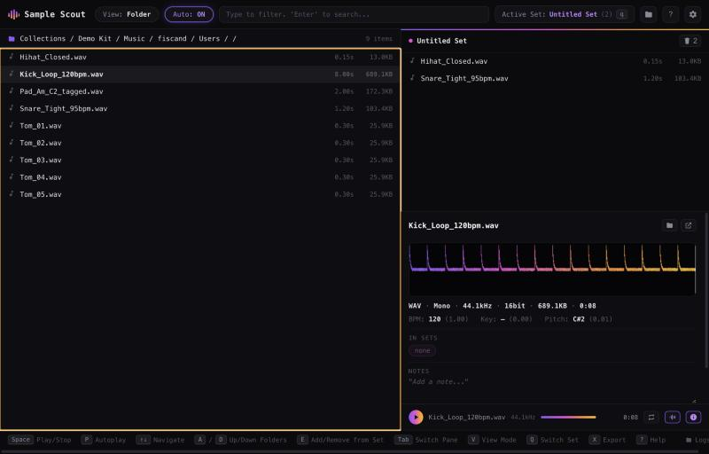

# Kit Crafter v2 — a Sample Scout Python recreation

A from-scratch Python reimplementation of the backend/engine and UI of
**Sample Scout** (`app.samplescout`, v1.2.4), reverse-engineered from
the vendor's own shipped universal macOS binary (not included in this
repo). No decompiled source or prior attempt was reused — everything
here was derived fresh from static analysis of that binary plus the two
ONNX models it ships.



## Setup (venv)

Requires Python 3.10+.

```bash
git clone https://github.com/andymann/kit-crafter-v2.git
cd kit-crafter-v2

python3 -m venv venv
source venv/bin/activate        # Windows: venv\Scripts\activate

pip install -r requirements.txt
```

Then either launch the desktop UI:

```bash
python desktop.py
```

or use the CLI (see [Usage](#usage) below). Deactivate the venv when
you're done with `deactivate`.

## What the original app is

A Tauri (Rust backend + native webview frontend) desktop sample
librarian/browser for producers/DJs: it indexes a folder of audio
samples into a SQLite library, detects BPM and musical key (via
filename/tag parsing, a fast autocorrelation estimator, and two bundled
ONNX neural nets), supports tagging, "sets" (ordered playlists), clip
regions with fades, waveform caching, and a configurable export/render
pipeline (mono-sum, high-pass, normalize, limiter, resample, bit-depth
conversion, manifest generation, cue points, post-export shell hook).

## How this was reverse-engineered

The binary (`sample-scout`, a universal x86_64/arm64 Mach-O, Tauri +
`tauri-plugin-*` + `symphonia`/`hound`/`rustfft`/`ort` (ONNX Runtime)
+ a bespoke `sample_scout_tools` crate) was never executed. Everything
below came from static string/symbol extraction over its `__TEXT`
section:

- **Every `CREATE TABLE` statement** in [`sample_scout/db.py`](sample_scout/db.py)
  is copied **byte-for-byte** from the binary's rodata (12 tables:
  `samples`, `sets`, `set_samples`, `collections`, `export_presets`,
  `app_preferences`, `migrations`, `tags`, `sample_tags`, `clips`,
  `set_clips`, `waveform_cache`).
- The **23 migration names**, the **15 default tag seeds**
  (`snare`, `hihat`, `percussion`, ...), and the full **COALESCE-based
  priority rules** for `bpm`/`key_name`/`key_numerical` (e.g.
  `bpm = COALESCE(bpm_tag, bpm_filename, bpm_beatthis, bpm_acf)`) were
  likewise recovered verbatim from literal `ALTER TABLE`/`UPDATE`/`INSERT`
  strings and are reproduced exactly in `db.py` / `scanner.py` / `tier2.py`.
- The **five regexes** used for filename/tag BPM & key parsing in
  [`sample_scout/metadata.py`](sample_scout/metadata.py) are copied
  character-for-character from the binary.
- The **Camelot wheel** key-numbering ([`camelot.py`](sample_scout/camelot.py))
  is confirmed (not guessed) by two 24-entry literal string tables found
  in rodata — one of Camelot codes (`"1A".."12A"`, `"1B".."12B"`), one
  of key names (`"G# minor"`, `"A major"`, ...) — so it's the industry-
  standard wheel, not a bespoke numbering.
- **~150 function/module names** of the two internal Rust crates
  (`sample_scout_tools::{key,tempo,autocorrelation,pitch,analysis}` and
  the main `sample_scout::*` binary's command surface — `scan`,
  `export_single_item`, `create_set`, `add_to_set`, `parse_key_tag`,
  `detect_acf_tempo`, `run_pyin`, `compute_cqt_spectrogram`,
  `build_mel_filterbank`, ...) were recovered from the mangled Rust `v0`
  symbol table and used to name/shape the equivalent Python modules
  (`analysis/autocorrelation.py`, `analysis/pitch.py`,
  `analysis/key_cnn.py`, `analysis/tempo_cnn.py`, `dsp.py`, `export.py`).
- The **two bundled ONNX models** (`musical_key_cnn_uint8.onnx`,
  `beat_this_small0_uint8.onnx`, copied into [`resources/`](resources/))
  were inspected directly with the `onnx` Python package (a one-time
  analysis step, not a runtime dependency — it's not in
  `requirements.txt`) to get their exact input/output tensor names and
  shapes: `cqt_spectrogram (1,1,105,T) -> logits (1,24)` and
  `mel_spectrogram (1,T,128) -> logits (1,T,2)`. This recreation **runs
  the real bundled weights** via `onnxruntime` rather than re-deriving
  them — recreating trained weights from a binary isn't meaningful;
  reusing the shipped model file for its stated purpose is.
- Everything else (manifest.txt text format, `mono_mode` enum values
  `sum`/`left`/`right`, `status` enum `normal`/`orphaned`/`offline`,
  the "Normalize (%s dB)"/"Limiter (%s dB)"/"-- no processing --" DSP
  description fragments) is likewise copied from literal strings found
  in the binary.

### What had to be inferred rather than read off verbatim

The CQT/mel-filterbank **preprocessing parameters** feeding the two ONNX
models (`key::build_all_cqt_kernels`, `tempo::build_mel_filterbank`) are
hand-rolled Rust code, not literal data, so their exact `fmin`/
`bins_per_octave`/`fmax` could not be read directly without full
instruction-level decompilation of those functions (out of scope given
the project's size — a 58MB binary). The model shapes exactly match two
published, named architectures (`beat_this_small0` = CPJKU's "Beat This!"
beat tracker; `musical_key_cnn` = Schreiber's key-cnn), so this
recreation uses **those papers' published preprocessing** instead of a
guess. Confirming this empirically: on a synthetic 120 BPM test loop,
`tempo_cnn.py` running the real `beat_this_small0_uint8.onnx` weights
returns exactly **120.0 BPM**, which is strong evidence the mel
preprocessing here is correct or very close to it. The key-CNN's exact
CQT framing is less certain (see the module's docstring) — the model
runs correctly, but you should treat `key_cnn`/`key_cnn_numerical`
output as a best-effort match on real-world material rather than an
exact clone of the original's Tier-2 key accuracy.

The bare-number-vs-track-number BPM disambiguation
(`metadata::is_bare_number_sequence`/`build_sequence_context`) and the
export `DSP:` description line for options other than Normalize/Limiter
(whose exact text was confirmed) are reasonable reconstructions of the
described behavior, not verbatim extractions.

### Deliberately out of scope

- **Licensing (`license::*`) and the auto-updater
  (`tauri-plugin-updater`, `dl.samplescout.app`).** These talk to the
  vendor's own servers/DRM; reproducing them would mean impersonating
  Sample Scout's infrastructure, which this recreation does not do.
- The realtime lock-free audio **playback** engine
  (`audio::run_audio_thread`, ring-buffer preload workers) — a
  performance-engineering concern that doesn't translate meaningfully
  to Python; the DSP primitives it depends on (fades, trim, channel
  conversion) are implemented in `dsp.py` and used by the export path.
- Keybindings file seeding, diagnostics/render-watchdog logging, and
  macOS-specific Finder drag-export — minor long-tail features.

## The UI

The app's own compiled frontend JS is embedded in the binary as a
compressed Tauri asset bundle (confirmed by `tauri://localhost` /
`index.html` asset-protocol strings), not as literal text, so it can't
be read out of the binary the way the schema/regexes were. Instead the
UI here was modeled on **real screenshots of the shipping app**, pulled
straight from the vendor's own marketing site
(`https://samplescout.app`, specifically its `sample-scout-browser-view.webp`
and `sample-scout-editor-view.webp` assets) and cross-checked against
the app icon's color palette. That gave an exact, pixel-level reference
for the real layout, copy, iconography and color system:

- Toolbar: logo + wordmark, `View: Folder` / `Auto: ON` pill toggles, a
  `Type to filter. 'Enter' to search...` box, an `Active Set: <name>
  (<count>)` badge with a `q` key hint, then open-folder / help / settings
  icon buttons.
- Left pane: `Collections / ...` breadcrumbs with an `N items` counter,
  then a monospace file list (folders and audio files mixed, duration +
  size right-aligned, a green checkmark for files already in the active
  set).
- Right-top pane: the active set's member list (colored dot + name +
  a clear/trash control).
- Right-bottom pane: waveform (the real app's signature purple → magenta
  → orange → gold gradient, brighter for the played portion), the
  `FMT · Channels · Rate · Bit depth · Size · Duration` line, the
  `BPM: _ (_) Key: _ (_) Pitch: _ (_)` analysis line, `IN SETS` / `NOTES`
  / `TAGS` sections (tags and set-membership as pill badges), and a
  scoped playback bar (play button, seek bar, time, waveform/info view
  toggles).
- A full-width keybindings footer (`Space Play/Stop`, `P Autoplay`,
  `↑↓ Navigate`, `A/D Up/Down Folders`, `E Add/Remove from Set`,
  `Tab Switch Pane`, `V View Mode`, `Q Switch Set`, `X Export`, `? Help`),
  copied verbatim from the real screenshots.
- **Clip editor** (press `V`, double-click the waveform, or click a
  `CLIP` row in the active-set pane), modeled on
  `sample-scout-editor-view.webp`: it replaces the bottom portion of the
  window with a zoomable/pannable waveform (mouse-wheel zoom, an overview
  minimap with its own nav arrows), a draggable clip-bounds selection,
  and two draggable fade handles rendered as the real app's rounded
  bezier-curve silhouette along the selection's top edge (`dsp.bezier_ease`'s
  `(width, cp_x, cp_y)` model, edited visually). Clips persist to the
  real `clips` table and can be added to a set (`set_clips`), renamed,
  deleted, or exported standalone (trimmed via the same `clip_start`/
  `clip_end` the CLI's export path already supported). The editor's own
  keybindings footer (`Space`, `←/→ Seek 1s`, `Shift+←/→ Nudge`,
  `Bksp Clear Clip`, `Esc Close Editor`) is likewise copied from the
  screenshot.
- **Settings** (gear icon): a master-volume slider (persisted to the
  real `app_preferences` table under the `master_volume` key — confirmed
  as a real preference by the `master_volumeRestored volume: ...`
  strings in the binary) and a full CRUD manager for the real
  `export_presets` table, with every column from the recovered schema
  exposed as a form field. The export dialog's preset dropdown reads
  from the same table, so a saved preset now drives real exports instead
  of only the ad hoc checkboxes.

It's backed by a small Flask API (`webapp/server.py`) that wraps the
same `sample_scout` engine used by the CLI — real filesystem browsing,
on-the-fly waveform-peak extraction, tagging, notes, sets, clips and the
export pipeline all work, and audio actually plays in-browser.
Architecturally this mirrors the original (a backend process serving a
webview-hosted UI) rather than reimplementing Tauri; `desktop.py` hosts
the same Flask app inside a real native window via `pywebview` instead
of a browser tab.

Not reproduced: the Logs panel (never seen open in any reference
screenshot, so nothing to model it on) and a few of the editor's icon
buttons whose exact behavior wasn't visible in the reference images
(e.g. the `[+]` bracket icon) were mapped to the closest reasonable
action rather than guessed blindly.

### Running the UI

With the venv from [Setup](#setup-venv) active:

```bash
python desktop.py                 # native window (pywebview)
# or, for a browser tab instead:
python -m webapp.server           # serves http://127.0.0.1:5177
```

## Layout

```
.
  resources/                     # the two real bundled ONNX models
  requirements.txt
  desktop.py                     # native-window (pywebview) launcher for the UI
  sample_scout/
    db.py            # schema + migrations (verbatim)
    metadata.py       # filename/tag BPM+key regex parsing (verbatim regexes)
    camelot.py        # Camelot wheel + key-CNN class order
    audio_probe.py    # probe + embedded-tag extraction
    analysis/
      autocorrelation.py  # Tier-1 ACF tempo (bpm_acf)
      pitch.py             # Tier-1 pYIN pitch
      key_cnn.py            # Tier-2 ONNX key model (bpm-independent)
      tempo_cnn.py          # Tier-2 ONNX beat_this model (bpm_beatthis)
    dsp.py            # fades, mono mixdown, filters, WAV/cue writing
    export.py         # export-preset pipeline + manifest.txt + post-cmd
    scanner.py         # folder scan -> samples table upsert
    tier2.py           # background ONNX analysis pass
    cli.py             # CLI front-end
  webapp/
    server.py          # Flask API wrapping sample_scout for the UI
    templates/index.html
    static/style.css    # exact dark theme / gradient / pill styling
    static/app.js        # browse, select, tag, play, export, keybindings
```

## Usage

With the venv from [Setup](#setup-venv) active:

```bash
python -m sample_scout.cli init
python -m sample_scout.cli scan /path/to/samples
python -m sample_scout.cli analyze          # Tier-2 ONNX pass (slower)
python -m sample_scout.cli search kick
python -m sample_scout.cli create-set "My Set"
python -m sample_scout.cli add-to-set 1 1
python -m sample_scout.cli export 1 --mono --normalize --manifest --destination ./out
```

All commands take `--db path/to/database.db` (defaults to
`~/.sample-scout-py/database.db`).
